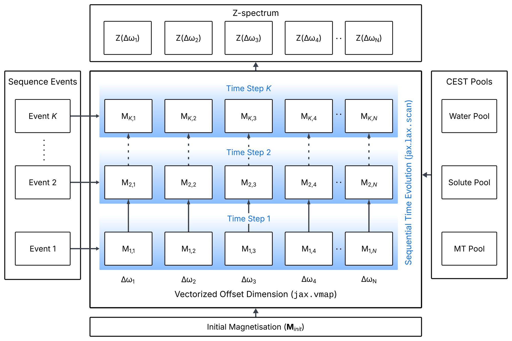
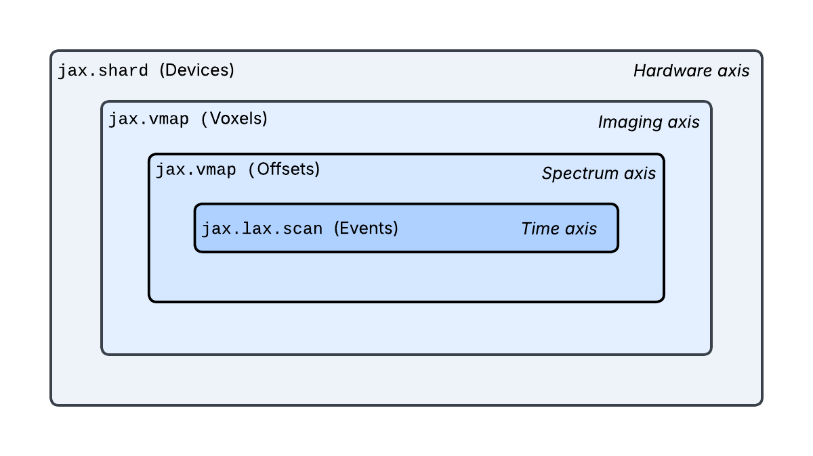

# BMC-JAX

**Differentiable, GPU-accelerated Bloch-McConnell simulation and quantitative CEST fitting in JAX.**


BMC-JAX simulates Z-spectra of multi-pool chemical exchange saturation transfer (CEST) models under
the scanner's own Pulseq sequence, and fits exchange rates, proton fractions and relaxation times
directly to measured data. The full Bloch-McConnell simulation runs inside the optimiser on the GPU,
and the Jacobian of the fit is obtained by automatic differentiation of the solver.

## Features

- **Scanner sequences.** Pulseq `.seq` files are simulated as acquired, with shaped pulses,
  interpulse gaps, spoilers and recovery delays. Saturation trains can also be built in code.
- **Pool models.** Water, CEST and magnetisation transfer (MT) pools, with Lorentzian or
  super-Lorentzian MT lineshapes, from Pulseq-CEST YAML configurations or defined in code.
- **Differentiable.** Jacobians by forward-mode automatic differentiation, with no finite-difference
  step size to choose.
- **Batched.** All frequency offsets in one call (`jax.vmap`), many voxels or samples per call, and
  several GPUs.
- **Fitting.** Bounded Levenberg-Marquardt. Samples are fitted independently (`fit`) or jointly with
  shared, per-sample and per-experiment parameters (`fit_joint`), optionally with the B0 spread
  inside a sample (`B0Spread`).
- **Precision.** float32 for speed, float64 for reference calculations.

## Installation

Requirements: Python 3.10 or later, NumPy, PyYAML and JAX 0.6 or later.

```bash
git clone https://github.com/MPR-UKD/BMC-JAX.git
cd BMC-JAX
pip install -e .
```

For GPU execution, install JAX with CUDA support as described in the
[JAX installation guide](https://docs.jax.dev/en/latest/installation.html), for example
`pip install -U "jax[cuda12]"`.

Optional extras, installed with `pip install -e ".[extra]"`:

| Extra | Adds | Needed for |
|---|---|---|
| `pulseq` | pypulseq | reading and writing Pulseq `.seq` files |
| `reference` | bmctool | comparison with the CPU reference implementation |
| `dev` | pytest | running the test suite |

## Quick start

Simulate a QUESP experiment (one amide pool, four saturation amplitudes) and fit the exchange rate
and the proton fraction back:

```python
import numpy as np
from bmc_jax.io import example_config
from bmc_jax.simulation import to_sim_params, initial_state
from bmc_jax.sequences import cw_saturation
from bmc_jax.fitting import FitSpec, FreeParam, Experiment, fit

params = example_config("amide")          # or from_yaml("your_model.yaml")
jp  = to_sim_params(params)
m0  = initial_state(jp)
ppm = np.linspace(-6, 6, 61)

# one experiment per saturation amplitude, stacked and fitted as one problem
ladder = Experiment.stack([
    Experiment(jp, cw_saturation(ppm, b1_uT=b, tsat_s=2.0, b0_T=params.system.b0), m0, params.mz_loc)
    for b in (0.5, 1.0, 2.0, 4.0)])

z = np.asarray(ladder.simulate())

spec = FitSpec([FreeParam("k", "cest_k", 0, scale=100.0, lo=5.0, hi=5000.0, x0=300.0),
                FreeParam("f", "cest_f", 0, scale=0.001, lo=1e-6, hi=0.05, x0=0.0005)])
res = fit(ladder, spec, z[None, :], n_per_block=len(ppm))
print(res.summary())
```

```
sample             k             f        rms
---------------------------------------------
     0       49.617    0.00090772    2.06e-05
```

The true values are k = 50 s⁻¹ and f = 9.01 × 10⁻⁴. The last digits depend on the device and the
precision.

## Method

The Bloch-McConnell equations are affine, dM/dt = A M + b. Appending a constant 1 to the
magnetisation vector moves b into the system matrix, so that every time step is a single matrix
exponential and no matrix inversion is required:

```
[ M ]'     [ A  b ] [ M ]
[ 1 ]   =  [ 0  0 ] [ 1 ]
```

The magnetisation is propagated through the sequence events in one compiled loop (`jax.lax.scan`),
at all frequency offsets at once (`jax.vmap`). The same graph yields the Jacobian.



The same kernel is batched over further axes, from the frequency offsets to voxels and to several
GPUs, and remains differentiable at every level.



## Package layout

| Module | Contents |
|---|---|
| `bmc_jax.simulation` | forward model: system matrix, time step, Z-spectrum, voxel batches, B0 spread, multi-GPU |
| `bmc_jax.sequences` | saturation sequences built in code or read from Pulseq `.seq` files |
| `bmc_jax.fitting` | `fit` and `fit_joint`, parameter specifications, Levenberg-Marquardt |
| `bmc_jax.design` | Cramer-Rao lower bound of a protocol (`crlb`) and protocol optimisation (`optimize_design`) |
| `bmc_jax.io` | Pulseq-CEST YAML configurations and example models |
| `bmc_jax.mrf` | MR fingerprinting dictionaries |
| `bmc_jax.settings` | float32 or float64, and the choice of matrix exponential |

## Tutorials

The [`examples/`](examples/) folder contains thirteen tutorials, meant to be read in order. Each script
runs on its own and prints an explanation together with its results.

| Tutorials | Topic |
|---|---|
| 01 to 03 | Basics: defining a model, simulating a Z-spectrum, simulating a Pulseq `.seq` file |
| 04 to 07 | Fitting simulated data: the Jacobian and automatic differentiation, fitting from one saturation level, the QUESP and QUEST ladders, many voxels at once |
| 08 to 11 | Fitting a measured seven-tube phantom (QUESP and QUEST at 3 T): each tube alone, water parameters shared by all tubes, one parameter per saturation amplitude. The data ship in [`examples/data/`](examples/data/). |
| 12 and 13 | Protocol design: the Cramer-Rao lower bound of a protocol, and a protocol optimised to lower it |

Tutorials 01 to 07, 12 and 13 run in seconds to a few minutes. Tutorials 08 to 11 take between 15
minutes and 3.5 hours on one GPU. [`examples/README.md`](examples/README.md) describes every tutorial
and lists the runtimes.

## Documentation

- [`docs/guide.md`](docs/guide.md): user guide. Joint fits with shared parameters, the stopping and
  bound rules of `fit_joint`, the B0 spread within a sample, the choice of matrix exponential, the
  Cramer-Rao bound and protocol design, and the conditions under which a fitted exchange rate is
  reliable.
- [`examples/README.md`](examples/README.md): overview of the tutorials, with runtimes.
- [`CHANGELOG.md`](CHANGELOG.md): changes between versions, including a table of renamed functions
  for code written for 0.1.0.
- [`tests/README.md`](tests/README.md): what the test suite checks and how to run it.

## Testing

```bash
pip install -e ".[dev]"
pytest
```

The tests check physical invariants of the forward model, recover known parameters from simulated
data, and compare every Jacobian with `jax.jacfwd`. They need no data files and no optional packages.

## Acknowledgements

BMC-JAX builds on two open-source projects:

- [PyPulseq](https://github.com/imr-framework/pypulseq), which is used to read and write Pulseq
  sequences.
- [BMCTool](https://github.com/schuenke/BMCTool) by Patrick Schünke, the Python Bloch-McConnell
  simulation tool of the [Pulseq-CEST](https://pulseq-cest.github.io) project. BMC-JAX is based on its
  code and its configuration format, and BMCTool serves as the reference implementation in the
  validation.

Pulseq-CEST is described in:

> Herz K, Mueller S, Perlman O, et al. Pulseq-CEST: Towards multi-site multi-vendor compatibility and
> reproducibility of CEST experiments using an open-source sequence standard. Magn Reson Med.
> 2021;86(4):1845-1858. https://doi.org/10.1002/mrm.28825

## License

MIT. See [LICENSE](LICENSE).
